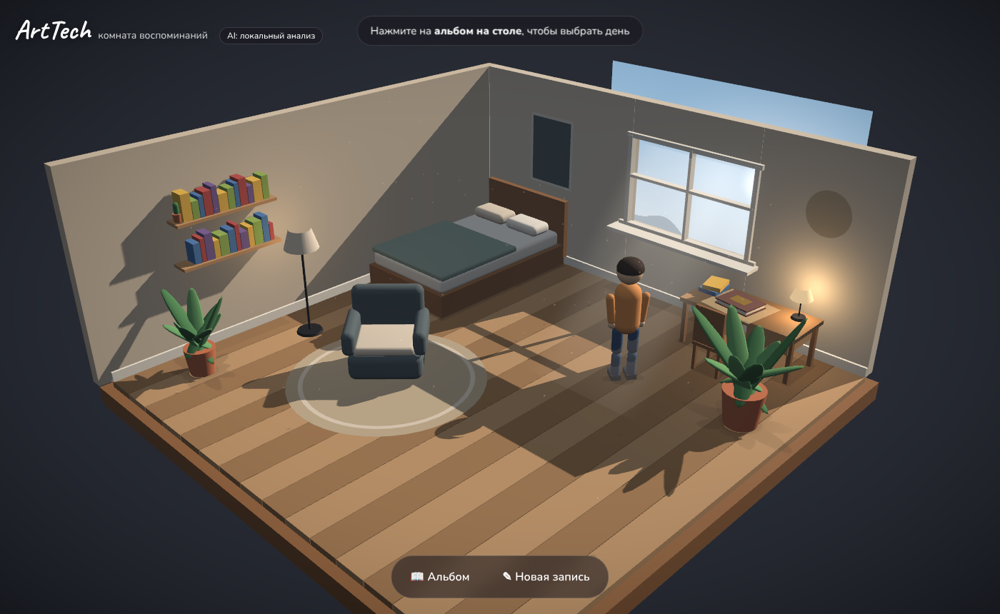
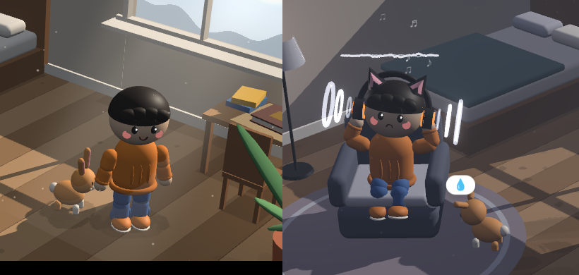
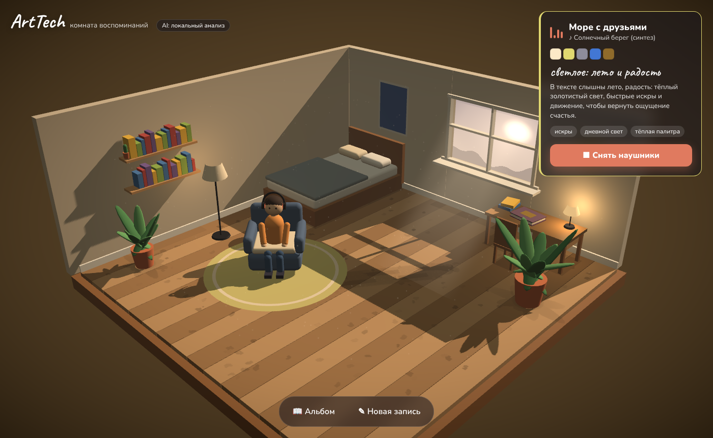
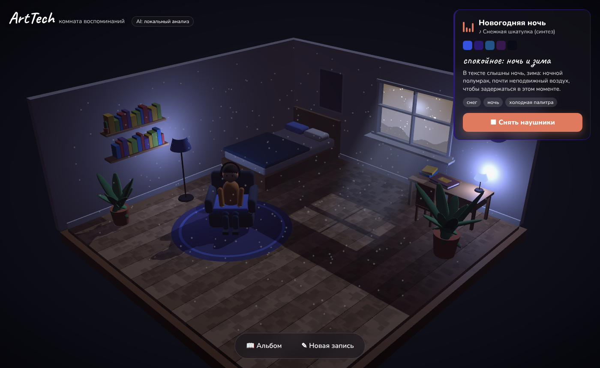

# ArtTech — комната воспоминаний

Интерактивный 3D-дневник: личные дни хранятся в альбоме на столе уютной комнаты. Выбираешь день, персонаж садится в кресло и надевает наушники, играет музыка, а комната меняет свет, палитру, небо за окном и частицы под настроение этого дня. Геометрия комнаты всегда одна и та же, меняется только атмосфера.





| Летний день | Новогодняя ночь |
|---|---|
|  |  |

## Быстрый старт

```bash
npm install
npm run dev          # фронтенд http://localhost:5173 + API http://localhost:8787
```

Чтобы атмосферу подбирал Claude, создайте `.env` по образцу `.env.example` и впишите `ANTHROPIC_API_KEY`. Без ключа всё работает на локальном анализаторе, так что демо не ломается без сети.

Продакшен-сборка: `npm run build && npm start` (сервер раздаёт `dist/` и API на одном порту).

## Что умеет

- **3D-комната** (Three.js + React Three Fiber + Drei): стены «кукольного домика», окно с небом, кровать, стол, кресло, полки, растения, лампы, мягкие тени.
- **Персонаж** с процедурными анимациями: ожидание, ходьба к креслу, посадка, надевание и снятие наушников, покачивание головой в такт.
- **Кастомизация персонажа** (кнопка «👕 Персонаж»): толстовка с капюшоном, футболка или кофта; цвета верха, штанов, кроссовок, волос и кожи; обычные наушники или наушники с кошачьими ушками, цвет корпуса и амбушюр. Настройки запоминаются в браузере.
- **Питомец**: кот, собака или кролик своего окраса. Ходит за персонажем, во время музыки садится у кресла и реагирует на настроение воспоминания (радуется, танцует, дремлет, грустит) или на настроение, выбранное вручную.
- **Музыка видна**: от наушников расходятся звуковые волны, над головой живая звуковая дорожка (форма волны из Web Audio) и всплывающие ноты. Лицо персонажа меняется под настроение трека.
- **Альбом**: книга на столе открывается по клику, развороты листаются с 3D-анимацией страниц (стрелки ← → тоже работают). При перелистывании комната даёт лёгкий намёк на атмосферу страницы.
- **Новая запись**: дата, текст, до 4 фото, музыка файлом или прямой ссылкой. Архив хранится в IndexedDB браузера, вместе с фото и аудио.
- **Атмосфера из входных данных** (не выбор готовой темы):
  - текст → темы (лето, дождь, зима, ночь, праздник, ностальгия…), валентность и энергия;
  - фото → доминирующие цвета (k-means по пикселям), их тон, насыщенность и светлота;
  - музыка → громкость, «яркость» звука и темп (автокорреляция огибающей).
  Из этого выводятся палитра, цвет и высота солнца, рассеянный свет, небо, дымка, контраст, тип/количество/скорость частиц, скорость анимаций, свечение и реакция на музыку.
- **Claude API** на сервере (`server/index.ts`): получает текст, уменьшенные фото и характеристики трека и возвращает те же параметры через structured outputs. Ключ живёт только на сервере.
- **Музыка запускается по действию пользователя**; сцена «дышит» под звук (анализатор Web Audio): лампы, частицы, свечение.
- **Три демо-воспоминания** с разными атмосферами: летнее море, дождливый вечер, новогодняя ночь. Картинки нарисованы в SVG, музыка синтезируется в браузере, поэтому никаких проблем с лицензиями.

## Как устроено

```
src/
  atmosphere/   параметры сцены, локальный анализатор, цвета фото, клиент к API
  audio/        аудио-движок (анализатор, файлы, ссылки) и синтез демо-музыки
  scene/        3D: комната, персонаж, альбом, частицы, свет и пост-обработка
  ui/           альбом с перелистыванием, форма записи, HUD
  data/demo.ts  три демо-воспоминания
  store.ts      состояние (zustand): фазы сцены, активное воспоминание
server/index.ts Express + Claude API (/api/health, /api/analyze)
```

Фазы сцены: `idle → walking → sitting → listening → unwinding → idle`. Атмосфера плавно перетекает к целевой каждый кадр (`scene/live.ts`), поэтому переходы мягкие.

## Распределение по ролям

- **3D Developer**: `src/scene/*` (модели, свет, анимации персонажа).
- **Frontend Developer**: `src/ui/*`, `styles.css`, `store.ts`.
- **AI / Backend Developer**: `server/index.ts`, `src/atmosphere/*`, `src/storage.ts` (можно заменить на Supabase, интерфейс тот же).

## Что можно добавить

- Встраиваемые плееры (Яндекс Музыка, YouTube, SoundCloud) вместо прямых ссылок.
- Синхронизация архива через Supabase.
- Свободное перемещение персонажа, другие комнаты, озвучка.

## Технологии

React 19, TypeScript, Vite, Three.js, @react-three/fiber, @react-three/drei, @react-three/postprocessing, zustand, idb-keyval, Express, @anthropic-ai/sdk (Claude), Web Audio API.
